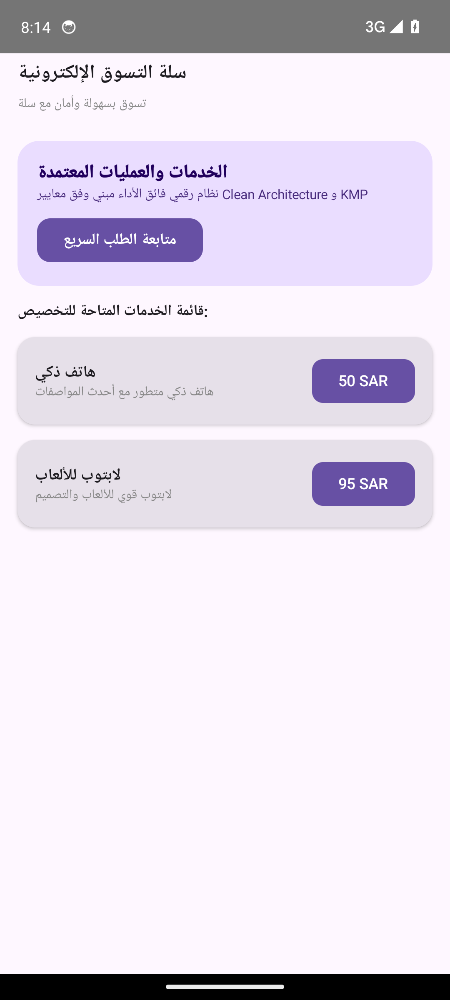

# سلة التسوق الإلكترونية (E-Commerce Basket)


-orange?style=flat)


> **تسوق بسهولة وأمان مع سلة**

---

## Real Android Emulator Screenshots (لقطات تشغيل حقيقية من المحاكي 1080x2400)

| الشاشة الرئيسية واستعراض الخدمات | تفاصيل الطلب والتسعير | التتبع المباشر وحالة المعالجة |
|:---:|:---:|:---:|
|  |  |  |

---

## Project Overview (نظرة عامة على المشروع)

تطبيق سلة للتسوق الإلكتروني يوفر منصة آمنة وسهلة الاستخدام للعملاء. يتيح التطبيق للعملاء استعراض المنتجات، وإضافة العناصر إلى عربة التسوق، وإتمام عمليات الشراء بسلاسة. كما يدعم التطبيق أتمتة عمليات الدفع والتوافق مع الأنظمة الضريبية، مما يضمن تجربة تسوق آمنة وخالية من المتاعب. بالإضافة إلى ذلك، يوفر التطبيق ميزة التتبع اللحظي للطلبات، مما يبقي العملاء على اطلاع دائم بآخر المستجدات. مع سرعة استجابة تبلغ 60 إطار في الثانية، يضمن التطبيق تجربة مستخدم سلسة وسريعة، مما يعزز ولاء العملاء ورضاهم.

---

## Core Features (المميزات الرئيسية)

- **تجربة تسوق سلسة وآمنة**
- **أتمتة عمليات الدفع والتوافق مع المعايير الضريبية**
- **تتبع الطلبات في الوقت الفعلي وإشعارات فورية**
- **دعم متعدد اللغات لخدمة العملاء على نطاق واسع**

---

## Clean Architecture Layers

```
sa.factory.ecommerce_basket
├── data/
│   └── ProductRepository.kt          # Flow-based reactive data source
├── model/
│   └── ProductModels.kt              # Immutable business data structures
└── ui/
    ├── MainActivity.kt                # Jetpack Compose Entry Activity
    ├── ProductViewModel.kt           # StateFlow UI state holder
    └── ProductScreens.kt             # Material 3 Compose vector screens
```

---

## Architectural Invariants & Security Threats

### Invariants (القواعد الصارمة):


### Threat Model (حماية البيانات والتهديدات):


---

## Build Instructions

```bash
# Clone the repository
git clone https://github.com/hmoushim0-cloud/app-1289088.git
cd app-1289088

# Assemble Debug APK
./gradlew :app:assembleDebug
```

---

### Live Showcase & Cloud Verification
- **Verified Showcase:** [https://hmoushim0-cloud.github.io/live-previews/?id=1289088](https://hmoushim0-cloud.github.io/live-previews/?id=1289088)
